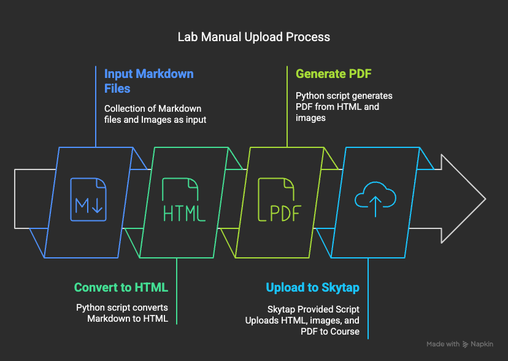

# Skytap Course Manager Publishing Tools

This repository provides the tooling used to convert Skytap Course Manager lab manuals, written in markdown, to HTML and publish them to one or more Skytap Course Manager courses. It is content-agnostic: your lab manual content (markdown, images, and a manifest describing where to publish it) lives in its own folder or repository, separate from this tooling.

## Purpose
The purpose of this repository is to help you convert structured, human-readable markdown content into HTML and publish it to any number of Skytap Course Manager courses, driven by a manifest file that lives alongside your content.



## How it works

1. A **content folder** (see `sample-content/` for an example/template) contains your `LabGuide.md`, any included markdown files and images, and a `manifest.yml` describing the list of Skytap Course Manager targets to publish to, each with its own source markdown file (and a course and hostname). This lets you create variant content for different targets if needed.
2. Running `publish.py --content-dir <path>` converts each target's markdown to HTML and uploads it to its Skytap Course Manager course (or a subset of targets, via `--target`). The generated HTML is temporary and is deleted once a target's publish finishes.
3. Credentials (`SKYTAP_API_KEY` / `SKYTAP_API_SECRET`) are shared across all targets and are read from a `.env` file kept with this tooling, not from the content folder.
4. A target can optionally list `translations:` (language + course_id). When present, `publish.py` machine-translates the target's markdown locally and publishes each translation to its own course (skipped entirely in `--draft` mode).

## Translations

A target in `manifest.yml` can include a `translations` list:

```yaml
targets:
  - name: "My Course"
    source: LabGuide.md
    course_id: "590"
    translations:
      - language: de
        course_id: "591"
      - language: fr
        course_id: "592"
```

For each translation, `publish.py` translates the target's source file and its transitive `::: include ::: ` files using a local Hugging Face `transformers` model (`facebook/nllb-200-distilled-600M` by default, CPU-only, no external API calls), writes them to `<content_dir>/<target_name>/translations/<language>/`, copies `images/` alongside them (without ever overwriting an existing image there), and publishes the result to the translation's `course_id`.

Notes:
- The first run downloads the model (~2.4GB) and caches it locally; CPU-only translation is slow, especially across many files/languages.
- Translated markdown files are always regenerated on each run; translated images are copied once and never overwritten, so you can manually replace them with localized screenshots.
- A two-tier glossary of terms that are never translated is merged from `translation-glossary.default.yml` (tooling-wide defaults) and an optional `translation-glossary.yml` in the content folder (content-specific additions).
- Protection of code blocks, links, images, placeholders, and `::: ::: ` directives from translation is heuristic (not a guarantee) — spot-check the first translated output per language.
- Add new language support by mapping its code to a FLORES-200 code in `LANGUAGE_CODES` in `translate.py`.
- To shield a whole block of text from translation (beyond single terms), wrap it in `::: notranslate :::` / `::: /notranslate :::`. The block is translated verbatim and the marker lines are stripped from the published HTML, e.g.:
  ```markdown
  ::: notranslate :::
  This text, across as many lines as needed, is published exactly as written in every language.
  ::: /notranslate :::
  ```

## Description of Files and Folders

- **publish.py**: The main entry point. Converts a content folder's markdown to HTML and publishes it to the targets listed in that folder's `manifest.yml`.
- **md2html.py**: Converts a markdown file to HTML, processing `::: include :::` directives, page breaks, and other Skytap-specific markup. Can also be run standalone via `--source`/`--output`.
- **translate.py**: Locally translates a target's markdown into other languages for the `translations` feature described above.
- **translation-glossary.default.yml**: Tooling-wide default list of terms that should never be translated.
- **html2md.py**: Converts an HTML file back into markdown. Useful for generating markdown from a Word document saved as HTML.
- **course_manual_manager/**: Provided by Skytap. Contains the code (run via Docker) that uploads an HTML manual, and any attachments it references, to a particular Skytap Course Manager course.
- **requirements.txt**: Python dependencies for the tooling.
- **.env.example**: Template for the `.env` file holding `SKYTAP_API_KEY`/`SKYTAP_API_SECRET`, shared by all publish targets.
- **sample-content/**: An example content folder you can copy as a starting point for a new lab manual, including a sample `manifest.yml`, `LabGuide.md`, `Cheatsheet.md` (markdown authoring reference), and `images/`.

## Instructions
1. Create a local python virtual environment and install the (`requirements.txt`).
    ```sh
    python3 -m venv .venv
    source .venv/bin/activate
    pip install -r requirements.txt
    ```
2. Copy `.env.example` to `.env` and fill in your Skytap Course Manager API key/secret.
3. Create your content folder (or copy `sample-content/` as a starting point). Refer to [Cheatsheet.md](./sample-content/Cheatsheet.md) for markdown authoring conventions. Edit `manifest.yml` in your content folder to list the targets you want to publish to, each with its own source markdown file and course.
4. Publish your lab manual:
    ```sh
    python3 publish.py --content-dir path/to/your-content
    ```
    Add `--draft` to upload without publishing (for previewing), or `--target NAME` (repeatable) to publish to only specific targets from the manifest.

## Useful Tools
This system is designed to be entirely platform independent, however, you may find the following tools particularly useful.

- [VS Code](https://code.visualstudio.com/download): An extensible text editor with auto-completion, syntax highlighting, markdown rendering, and code debugging capabilities.
- [Markdown Sync Image](https://marketplace.visualstudio.com/items?itemName=wangtao0101.markdown-sync-image): An extension for VS Code that allows a more powerfull method to "paste" images into markdown.  With it you can specify a path where images files will land and a naming convention for the files.  Or you have have it prompt for a file name with each paste.
- [Code Spell Checker](https://marketplace.visualstudio.com/items?itemName=streetsidesoftware.code-spell-checker): An extension for VS Code that adds a rudimentary spell checker.  It's not very powerful, but it helps.
- Some kind of text expansion utility like TextExpander or PhraseExpress to reduce some frequently used markups to just a few keystrokes.
